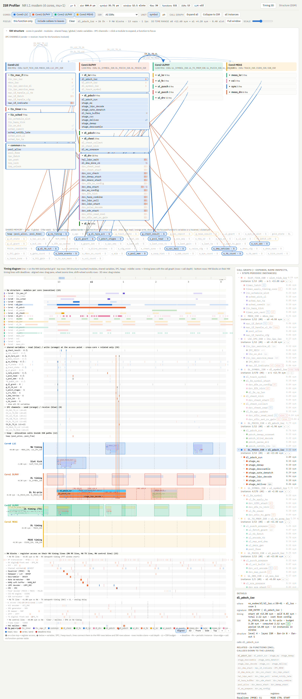
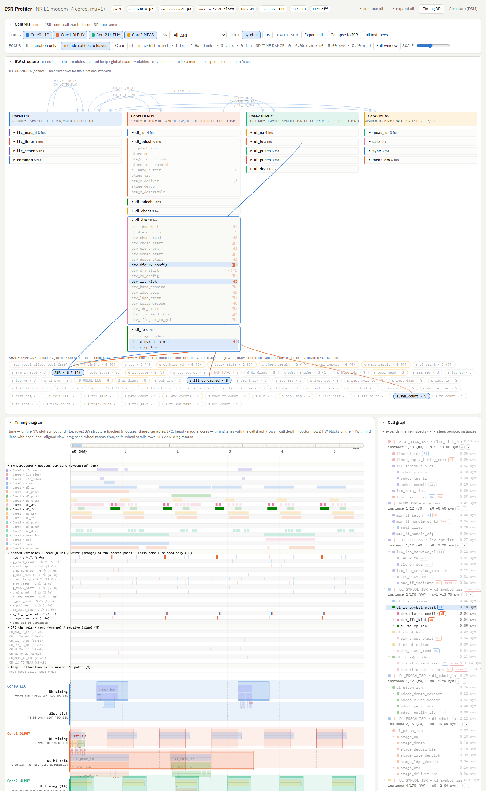

# isrprof — ISR / timing / HW-access profiler for 3GPP modem firmware

`isrprof` reads interrupt-driven embedded C sources plus a YAML config and renders one
self-contained HTML page: a **unified timing diagram** (SW structure touches on top, per-core ISR
call graphs in the middle, HW block control timing at the bottom, all on one time axis), a SW
structure diagram, HW block cards, and a Structure101-style dependency view.

## The timing model

* **Timing lines** (`timing_items`): *NW timing* is the reference. Every other line is NW ± offset and
  can be added freely: `slot_tick` (−1 sym), `dl` / `dl_hi` (−0.3 sym), `ul` (+TA), `meas`, and HW lines
  such as `hw_rx` (FFT window), `hw_tx` (DAC), `hw_ctrl`.
* **SW timing**: every ISR is placed on a sw line (`isrs[].timing`) with `start`, `length` (budget
  envelope) and `period`; periodic ISRs are repeated across the whole window (10+ slots are fine).
  The call tree under each ISR comes from the code (AST-level call graph down to the leaves,
  function-pointer / dispatch tables included); each function's self cost comes from a trace CSV,
  the config (exact names or glob patterns) or the optional LLM estimator.
* **HW timing**: every HW block lives on a HW line (`hw.blocks[].line`); its deadlines (`at`,
  optional `period`, optional `cores` / `isrs` filters) are expressed in that line's frame. Register
  accesses are detected from the access macros (`HW_RD / HW_WR / HW_RMW / HW_POLL …`) inside the
  functions and timed by their position in the function, then checked against the destination's
  deadline (periodic deadlines are checked per period).

## The page

```
┌ SW structure (diagram) ─ cores in parallel · modules · heap / global / static · IPC ─────────────┐
├ Timing diagram  (x = time on the NW slot / symbol grid) ─────────────────────────────────────────┤
│  SW structure touch rows   modules per core · shared variables (r/w) · IPC · heap   (z = behind) │
│  Core → timing lanes       ISR call graph: one row per call depth (icicle)          (z = depth)  │
│                            ● on a box = register access · ◆ under a box = variable / IPC / heap  │
│  HW block rows             register accesses + deadline ticks, grouped by HW line  (z = front)   │
├ HW blocks (cards) ───────────────────────────────────────────────────────────────────────────────┤
└ Structure tab: DSM (levelized, feedback in red) · LSM · tangles · fat · layer-rule violations ───┘
```

* **Aligned view** (default): orthographic front view, so every row group shares the same horizontal
  time axis; drag pans time, wheel zooms time around the cursor, shift+wheel scrolls rows, the
  overview bar at the top shows the whole window (drag on it to zoom, double-click to reset).
* **Tilt view**: the same orthographic camera rotated around the time axis, so call depth, the SW rows
  (behind) and the HW rows (in front) read as depth while time stays pixel-aligned.
* **3D view**: perspective with free rotation; depth is call depth, with the SW structure rows one
  layer behind and the HW rows in front of the deepest call level. The focused subtree is framed.
* **Why a 3D scene at all**: the diagram is one three.js scene; the third axis carries call depth and
  the SW-structure → calls → HW layering. Aligned is a projection of it (exact time alignment), Tilt
  shows the depth without losing alignment, 3D is for free inspection.
* **Every window collapses**: Controls, SW structure, Timing diagram, Call graph, Details, HW blocks
  and the Structure-tab panels are `<details>`; *collapse all / expand all* in the header; the state
  is remembered per browser.
* **Focus**: click a function (box, call-graph row, SW-structure row, timeline label). *this function
  only* relates just that function; *include callees to leaves* (default) relates its whole call
  subtree. Related SW rows / variables / IPC / modules / HW blocks / registers are highlighted and
  connected with lines, everything else is dimmed, and the Details panel lists the related set.
  Clicking a HW block (card, row) does the reverse. `Esc` / `Clear` resets.
* **Periodic instances**: `#k` on the ISR root; ◂ ▸ in the call graph steps instances; subtrees are
  drawn for the shown instance (or all, with *all instances*); expand / collapse applies to every
  instance.
* **Variables, structures and registers**: a shared-variable row (`ASA · G ® ⚠ (3 fn)`) expands into one
  row per first-level user function (`c1 · dl_fe_symbol_start [w] .dl.symbol_count`) plus one row per
  touched field; clicking a pill in the SW structure diagram shows the same per-core user list in the
  Details panel and opens the users' modules. A HW block row expands into its registers. ® marks
  variables registered in the config, ⚠ marks cross-core variables; tooltips name the accessor macro.
* **Any number of cores**: cores are data (`cores[]`); lanes stack per core and the SW structure
  diagram wraps core columns (`viewer.sw_structure.columns`, default 4). `tests/test_many_cores.py`
  builds an 8-core variant of the NR sample.
* **Deep links**: tokens joined by `--`: `#sel-DL_PDSCH_ISR--range-0.9~1.3--view-3d`,
  `#selonly-<function>`, `#structure`.

## Screenshots (NR modem sample)

| | |
|---|---|
|  aligned view, `DL_PDSCH_ISR` focused |  tilt view, `dl_fe_symbol_start` focused |
|  3D view framing the focused subtree |  Structure tab: DSM, LSM, violations |

## Quick start

```bash
pip install -r requirements.txt            # pyyaml (+ anthropic if you enable the LLM helpers)
python -m isrprof --config examples/nr_modem_config.yaml      # -> examples/out/nr_modem.html
python -m isrprof --config examples/sample_config.yaml        # -> examples/out/profile.html
python -m unittest discover -s tests -v
```

`examples/nr_modem` is a 4-core NR L1 built in the multi-core ISR style of real modem firmware:
core0 L1C (slot tick, MAC mailbox, mid-slot IPC), core1 DL PHY (symbol / PDCCH / PDSCH ISRs over the
RX chain RFIC→DFE→FFT→CHEST→EQ→DEMAP→DESCR→RDM/HARQ→LDPC→CRC), core2 UL PHY (symbol / PUSCH prep /
PUCCH / SRS over ULENC→MAP→IFFT→DFE_TX→RFIC), core3 MEAS (TTL/FTL tracking, CSI-RS, SSB). It uses
macro-wrapped ISR entries (`ISR_ENTRY(name)`), a function-pointer stage table for the PDSCH
pipeline, `HW_POLL` busy-waits, cross-core shared state and a few deliberate smells (a tangle,
HAL→control and pipeline→control upward calls, heap allocation in ISR paths, two deadline misses).

## Config reference (both example configs are fully commented)

Time expressions: `"1.2 symbol"`, `"0.5 slot"`, `"-30 us"`, `"2 ms"`, `"1 subframe"` (bare numbers = symbols).

| section | content |
|---|---|
| `project.sources` | globs for `.c` / `.h` files |
| `numerology` | `mu`, `symbols_per_slot`, optional exact `symbol_us` |
| `cores[]` | `id`, `name`, `clock_mhz`, `modules[] {name, files[]}` (file globs → module → core) |
| `timing_items[]` | lines: `id`, `name`, `offset` (vs NW), `kind` (`ref` / `sw` / `hw`), `priority`, `description` |
| `isrs[]` | `name`, `core`, `timing` (line), `entry`, `start`, `length`, `period`, `priority` |
| `hw.macros` | read / write / rmw macro names with the default `block_arg` / `reg_arg`; `custom[]` for any other layout: `{name, kind, reg_arg, block_arg}` (e.g. `REGISTER_READ(reg, , block)`), `block:` for a fixed block, `block_from_reg:` regex to derive the block from the register name; `auto_detect_volatile` |
| `hw.block_aliases` | block names used in code → block ids (matching is also case-insensitive) |
| `memory.globals` | registered shared structures / variables (`{name, kind, note}`) tracked even when defined outside the sources; direct accesses (`ASA.dl.x`) are recorded per field |
| `memory.access_macros` | accessor macros that read / write a registered variable: `{name, rw, var | var_arg, field_arg}` (`ASA_GET(dl.x)`, `SHM_WR(ASA, ul.y, v)`) |
| `hw.blocks[]` | `id`, `name`, `base`, `regs`, `line`, `pos`, `deadline` or `deadlines[] {timing?, at, period?, note?, cores?, isrs?}` |
| `memory` | heap functions, IPC macros + channel argument + channels (`from` / `to` core) |
| `architecture` | ordered `layers[]` (globs on functions / files / modules), `rules[] {deny: {from, to}}`, `fat_threshold`, `allow_skip_layer`, `include_unreached` |
| `cost_model` | `function_costs` (exact names or globs, first match wins), `default_cost`, `external_cost`, `trace_file` CSV, `source_priority` |
| `llm` | see below |
| `viewer` | appearance: `default_view` (aligned / tilt / 3d), `tilt_deg`, `theme`, `unit`, `row_px`, `label_margin_px`, `expand_depth`, `max_instances`, `connectors` (all / focus / none), `legend`, `colors` (`palette_light`, `palette_dark`, `read`, `write`, `miss`, `heap`, `accent`), `groups` (per row group: `open`, `functions`, `all`, `registers`), `sw_structure.open_modules`, `window_range` |
| `annotations` / `annotations_file` | free-text notes for `functions`, `blocks`, `variables`, `isrs`, shown in tooltips and details |
| `output` | html / json paths and the visible time `window` (NW frame) |

## Optional LLM assistance

Disabled by default. Enable with `llm.enabled: true` and an API key in the environment variable named
by `llm.api_key_env` (or an `ant auth login` profile). The official `anthropic` SDK is used
(`pip install anthropic`); model, effort, max tokens, cache file, system prompt and every task prompt
are configurable. Tasks: `estimate_costs` (WCET for functions without trace / config cost),
`classify_hw_macro` (unknown register macros → read/write/block-arg), `summarize` (tooltip
summaries), `suggest_layers`. Replies are cached in `llm.cache_file`.

## Package layout

```
isrprof/
  config.py      config loading, time-unit normalisation, timing lines, HW lines / deadlines
  timing.py      3GPP numerology helpers
  cparser.py     token-level C front-end: functions (incl. macro-wrapped entries), calls, dispatch
                 tables, HW macros, globals/statics (+ access position), IPC, heap
  callgraph.py   per-ISR call trees on the timing lines, HW events vs per-line / per-core deadlines
  structure.py   Structure101-style DSM, levelization, tangles, fat, layer rules, per-ISR slices
  llm.py         optional Anthropic-backed helpers
  pipeline.py    glue -> profile JSON
  render.py      assembles templates/parts/* into the single-file viewer
  templates/parts/
    00_head.html  tokens + CSS      10_body.html  markup      20_data.html  JSON slot + three.js
    30_core.js    data / state / focus / instances      40_scene3d.js  unified timing diagram (three.js, 2D fallback)
    50_panels.js  call graph, details, SW structure, HW cards      60_rows.js  row models (SW touch / HW)
    70_structure.js  DSM / LSM      80_init.js  wiring, deep links
```

The parser is a pre-processor-free token parser so vendor trees work without an include path. A
`libclang` backend can be dropped in as `isrprof/clang_backend.py` exposing `parse(cfg) -> ParseResult`
and selected with `parser.backend: libclang`.
