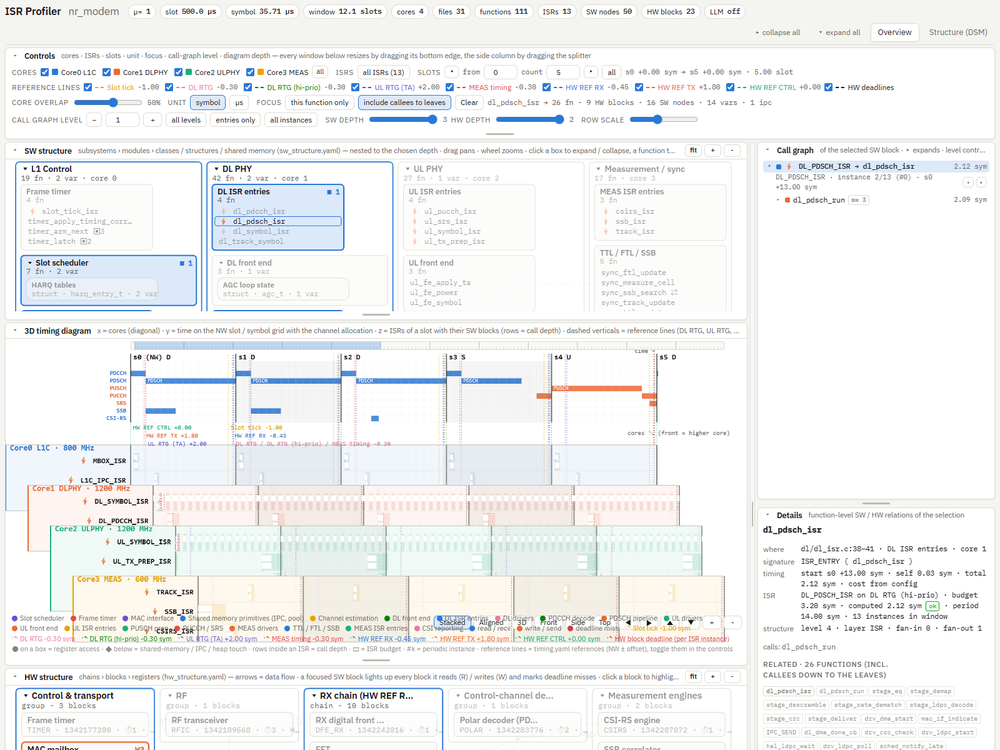
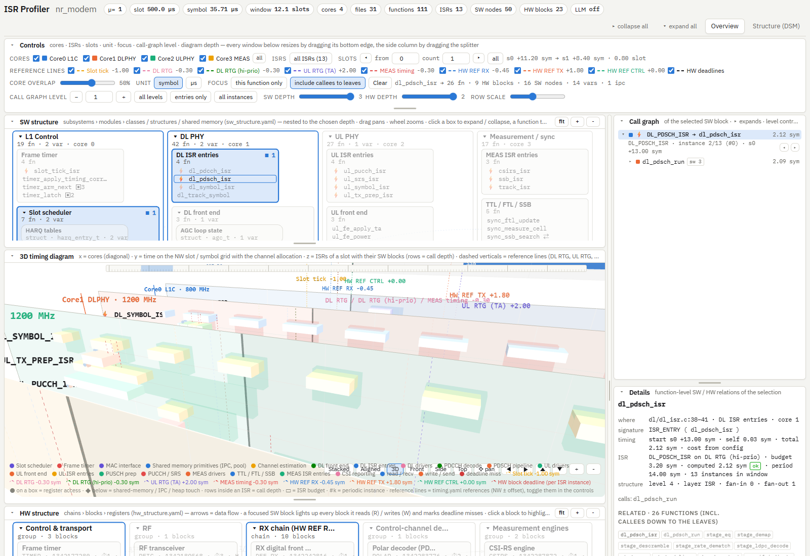
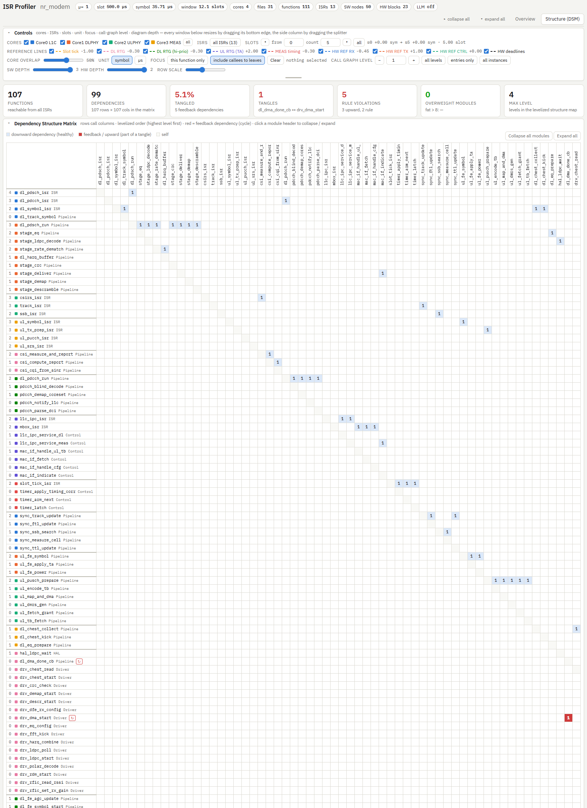
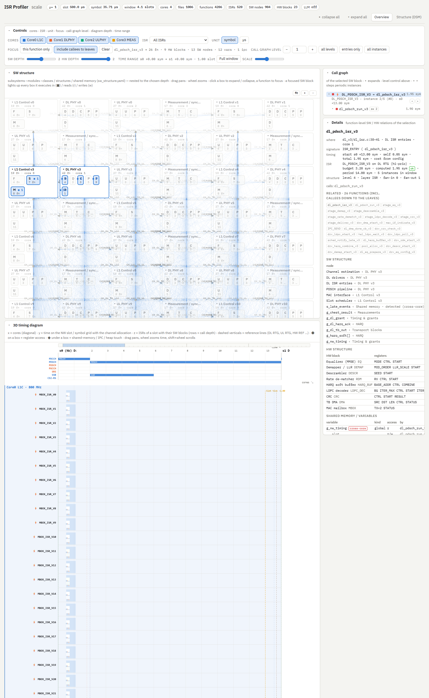

# isrprof — ISR / timing / HW-access profiler for 3GPP modem firmware

`isrprof` reads interrupt-driven embedded C sources plus a **profile** (the user inputs, one YAML file per
concern) and renders one self-contained HTML page with three stacked overlays and a detail column:

```
┌ SW structure ─ subsystems › modules › classes / structures / shared memory (sw_structure.yaml) ──────┐┌ Call graph ───┐
│   nested boxes to a chosen depth · relations as arrows · lights up what the focused SW block touches  ││ of the focused │
├ 3D timing diagram (timing.yaml) ─────────────────────────────────────────────────────────────────────┤│ block, level   │
│   x = cores (diagonal) · y = NW slot / symbol grid + channel allocation · z = ISRs of a slot with     ││ control, ◂ ▸  │
│   their SW blocks (rows = call depth) · dashed verticals = reference lines (DL RTG, UL RTG, HW REF)  │├ Details ──────┤
├ HW structure (hw_structure.yaml) ────────────────────────────────────────────────────────────────────┤│ function-level │
│   chains › blocks › registers · data-flow arrows · R / W / deadline-miss badges for the focus        ││ SW / HW links  │
└──────────────────────────────────────────────────────────────────────────────────────────────────────┘└────────────────┘
  Structure tab: Structure101-style DSM (levelized, feedback in red) · LSM · tangles · layer-rule violations
```

Every diagram pans (drag) and zooms (wheel); the three overlays are sized to share one screen and every
window can be resized by dragging its bottom edge (the side column by dragging the splitter; double-click
resets). Cores are checkboxes, ISRs a checkbox list (filter, all / none / "only this core"), and the
*Slots* control picks which NW slots are shown (default: 5 from slot 0, ◂ ▸ step, *all* = whole window).
The *Stacked* view draws the core planes like a deck of cards — core 0 at the back, every next core in
front and shifted down-right, the *Core overlap* slider sets how much a plane covers the one behind it
(0 % = no overlap); the *3D* view stacks them in real depth, higher cores closer to the viewer, and moves with the
right mouse button, the *✥ pan* mode, the ◀ ▶ ▲ ▼ buttons or the arrow keys. The dashed verticals are the
reference lines of `timing.yaml` (`references`: NW ± offset, one colour each, listed in the legend and switchable
in the controls) and, in red, the HW block deadlines of `hw_structure.yaml` drawn per ISR instance. Clicking a SW block
in the timing diagram (a function box or an ISR row) focuses it: the SW structure highlights every box it
executes in (■) / reads (r) / writes (w), the HW structure every block it touches (R / W, ✗ for deadline
misses), the call graph on the right shows its subtree, and Details lists the function-level relations.
*this function only* vs *include callees to leaves* decides whether the focus is the function or its whole
call closure; *call graph level* sets how many levels unfold (every node can still be expanded / collapsed
individually); *SW depth* / *HW depth* set how deep the structure diagrams nest.



| | |
|---|---|
|  3D view framing the focused PDSCH pipeline |  Structure tab: DSM, LSM, violations |
|  synthetic 40-copy tree (1006 files, 4206 functions, 520 ISRs) | |

Porting to a new tree / machine: see **[docs/PORTING.md](docs/PORTING.md)** (inputs, outputs, step-by-step).

## Profiles: the user inputs

A profile is a directory under `profiles/` (or `$ISRPROF_PROFILES`); each input is its own file so the SW
structure, the timing diagram and the HW structure can be edited and versioned independently. Outputs go to
`output/<name>/` (HTML, JSON, and `profile.resolved.yaml` = the merged inputs that produced them).

| file | content |
|---|---|
| `profile.yaml` | name, which input files to use, output location, `viewer` appearance, optional `llm` |
| `build.yaml` | source `root`, `sources` globs, `cmake` / `build_command` (recorded), `compile_commands` (translation units + `-D` / `-I` per file), `exclude`, `parser` options |
| `sw_structure.yaml` | `nodes` hierarchy (kind, `files` / `functions` / `variables` → code), `relations`, `depth`, `touch` rules (registered globals, accessor macros, heap / IPC primitives), `architecture` layers and rules |
| `timing.yaml` | `numerology`, `cores` (x axis), `references` (NW ± offset lines), `channels` (TDD pattern + PDCCH / PDSCH / PUCCH / PUSCH / SSB / CSI-RS / SRS allocation), `isrs` (z axis: ISR → reference line, start, length, period, entry), `window`, `cost_model` |
| `hw_structure.yaml` | `nodes` hierarchy (chains / groups / blocks with `regs`, `line`, `deadline(s)`), `links` (data flow), register-access `macros`, `block_aliases` |
| `annotations.yaml` | free-text notes for functions, blocks, variables, ISRs, nodes |

```bash
pip install -r requirements.txt                 # pyyaml (+ anthropic if you enable the LLM helpers)
python -m isrprof list                          # stored profiles
python -m isrprof run nr_modem                  # -> output/nr_modem/profile.html
python -m isrprof new my_modem --from nr_modem  # store a copy to adapt (or without --from: blank template)
python -m isrprof run path/to/profile.yaml      # a profile anywhere; a legacy single-file config also works
python -m unittest discover -s tests -v
```

`profiles/nr_modem` (fully commented) describes `examples/nr_modem`: a 4-core NR L1 built in the multi-core
ISR style of real modem firmware — core0 L1C (slot tick, MAC mailbox, mid-slot IPC), core1 DL PHY (symbol /
PDCCH / PDSCH ISRs over RFIC→DFE→FFT→CHEST→EQ→DEMAP→DESCR→RDM/HARQ→LDPC→CRC), core2 UL PHY (symbol /
PUSCH prep / PUCCH / SRS over ULENC→MAP→IFFT→DFE_TX→RFIC), core3 MEAS (TTL/FTL tracking, CSI-RS, SSB). It uses
macro-wrapped ISR entries (`ISR_ENTRY(name)`), a function-pointer stage table for the PDSCH pipeline, `HW_POLL`
busy-waits, a registered platform structure (`ASA`, direct and via `ASA_GET` / `ASA_SET`), cross-core shared
state, a `CMakeLists.txt` + `build/compile_commands.json`, and a few deliberate smells (a tangle, HAL→control
and pipeline→control upward calls, heap allocation in ISR paths, two deadline misses).

### How the inputs map to the picture

* **SW structure** — `nodes` are drawn as nested boxes down to `depth`. A node reaches the code through
  `files` (globs relative to `build.root`; every function in them belongs to the node, and these nodes also
  define the module → core map), `functions` (name globs) and `variables` (globals / statics / registered
  structures). `core` is inherited by children. Files no node claims appear under an implicit
  *«core» · files without SW node* box; cross-core globals no node declares under *Shared memory · detected*
  (`auto_variables: cross_core | all | none`). `relations` are design-level arrows; IPC arrows are derived
  from the `touch.ipc` primitives. A touch is detected from the code: direct accesses to the node's variables
  (per structure field), accessor macros (`ASA_GET(dl.x)` → read `ASA.dl.x`, any argument layout), heap
  functions and IPC macros.
* **3D timing diagram** — `references` are the vertical dashed lines (NW ± offset, repeated per slot);
  every ISR sits on one of them with `start` / `length` in symbols (start 0.7 on `dl_rtg` = 0.7 symbols after
  the DL RTG line of the slot). `channels` draws the 3GPP allocation on the NW axis: `tdd_pattern: DDDSU`
  decides the slot type, each item has `symbols: [start, length]` and `slots: all | dl | ul | special |
  [indices]` (+ `period_slots`). The call tree under each ISR comes from the code (down to the leaves,
  function-pointer / dispatch tables included); self costs come from a trace CSV, `cost_model.function_costs`
  (exact names, then globs) or the optional LLM estimator. Register accesses are timed by their position in
  the function and checked against the destination block's deadline (per period, per core / ISR filter).
* **HW structure** — nodes with `regs` are blocks the code can touch through the registered `macros`
  (`HW_WR(block, reg, v)` by argument position, `custom` entries for any other layout, a fixed block or a
  block derived from the register name, `auto_detect_volatile` for `*(volatile …)` macros). Deadlines are
  expressed on the block's reference `line`; `links` are the data-flow arrows.
* **Build** — `compile_commands.json` (CMake `-DCMAKE_EXPORT_COMPILE_COMMANDS=ON`, Bear, or
  `tools/gen_compile_commands.py`) defines the translation units; nothing is executed. The resolved profile
  records the cmake / build commands next to the outputs.

Time expressions: `"1.2 symbol"`, `"0.5 slot"`, `"-30 us"`, `"2 ms"`, `"1 subframe"` (bare numbers = symbols).

### Viewer options (`profile.yaml: viewer`)

`default_view` (tilt / aligned / 3d), `tilt_dx_px`, `theme`, `unit`, `row_px`, `label_margin_px`,
`expand_depth`, `max_instances`, `max_boxes` / `max_labels` (level of detail), `legend`, `colors`,
`channels.row_px`, `sw_structure` / `hw_structure` (`depth`, `columns`, `open`), `window_range`, `default_slots`
(5), `stack_overlap` (0.5), `dsm_max_functions`. Deep links: `#sel-DL_PDSCH_ISR--range-0.9~1.3--view-3d`,
`#selonly-<function>`, `#level-4--swdepth-2`, `#isr-DL_PDSCH_ISR,DL_SYMBOL_ISR`, `#slots-2~3`, `#overlap-70`,
`#structure`, `#selftest`.

## Performance

The parser is a pre-processor-free token parser (vendor trees work without an include path); file → module
and function → layer lookups are resolved once, so a 1000-file / 4200-function tree analyses in about 2 s.
The viewer batches everything: one instanced mesh per mark type, merged line segments, cached label
textures, flattened call trees with cached visibility, a sparse / canvas DSM above 160 rows, and
level-of-detail caps (`max_boxes`, `max_labels`, subtrees only on the shown periodic instance when the
window holds too many). A selection change recolours what is on screen instead of rebuilding it. On the
synthetic 40-copy tree (`tools/gen_scale.py 40`: 1006 files, 4206 functions, 520 ISRs, 9200 boxes) every
interaction in the self-test stays well under a second in a software-rendered headless browser.

## Verification

```bash
python -m unittest discover -s tests -v          # pipeline, profiles, build info, structures, parser, scale
python tools/check_js.py                         # viewer JS syntax (pip install esprima)
python tools/verify_viewer.py output/nr_modem/profile.html      # drives the page in headless Edge / Chrome
python tools/screenshot.py output/nr_modem/profile.html shot.png --hash sel-DL_PDSCH_ISR
python tools/gen_scale.py 40 --out /tmp/scale40  # synthetic big tree for benchmarks
```

`verify_viewer.py` opens the page with `#selftest`: the built-in self-test selects ISR roots, nested boxes,
HW blocks and SW nodes, switches focus modes, levels, depths, views, time ranges, cores, ISR filters, units
and tabs, and reports per-step results, timings and JS errors; the script checks that every interaction had
the expected effect (works from any shell; the Chromium child-process variables inherited from VS Code are stripped).

## Optional LLM assistance

Disabled by default (`llm.enabled: false` in `profile.yaml`). With the `anthropic` SDK and an API key in the
environment variable named by `llm.api_key_env`, the tasks `estimate_costs` (WCET for functions without
trace / config cost), `classify_hw_macro` (unknown register macros), `summarize` (tooltip summaries) and
`suggest_layers` can be enabled; model, effort, prompts and the reply cache are configurable.

## Package layout

```
isrprof/
  profile.py     profiles: discovery, store (new / clone), load (merge the part files), resolved copy
  build.py       source root, globs, compile_commands.json / cmake info, exclude, parser options
  config.py      normalisation of every section -> Config (times in us, hierarchies flattened)
  timing.py      3GPP numerology helpers
  cparser.py     token-level C front-end: functions (incl. macro-wrapped entries), calls, dispatch tables,
                 HW macros, globals/statics (+ access position, structure fields), IPC, heap
  callgraph.py   per-ISR call trees on the reference lines, HW events vs per-line / per-core deadlines
  structure.py   Structure101-style DSM, levelization, tangles, fat, layer rules, per-ISR slices
  pipeline.py    glue -> profile JSON (SW / HW structure nodes, touch index, channels, build summary)
  llm.py         optional Anthropic-backed helpers
  render.py      assembles templates/parts/* (+ vendored three.js) into the single-file viewer
  templates/parts/
    00_head.html  CSS    10_body.html  markup    20_data.html  JSON slot + vendor script
    30_core.js    data / state / flattened trees / focus relations
    40_scene3d.js 3D timing diagram (core planes, ruler + channels, instanced marks, 2D fallback)
    50_panels.js  call graph of the selection, details      60_diagram.js  nested SW / HW structure diagrams
    70_structure.js  DSM (table / canvas) · LSM            80_init.js     controls, deep links, self-test
profiles/nr_modem/   the NR modem profile (inputs)       examples/nr_modem/   its sources (+ CMake, compile_commands)
examples/sample_config.yaml   legacy single-file config (3-core sample)
tools/               check_js.py · verify_viewer.py · screenshot.py · gen_scale.py · gen_compile_commands.py
```

A `libclang` backend can be dropped in as `isrprof/clang_backend.py` exposing `parse(cfg) -> ParseResult` and
selected with `parser.backend: libclang` in `build.yaml`.
